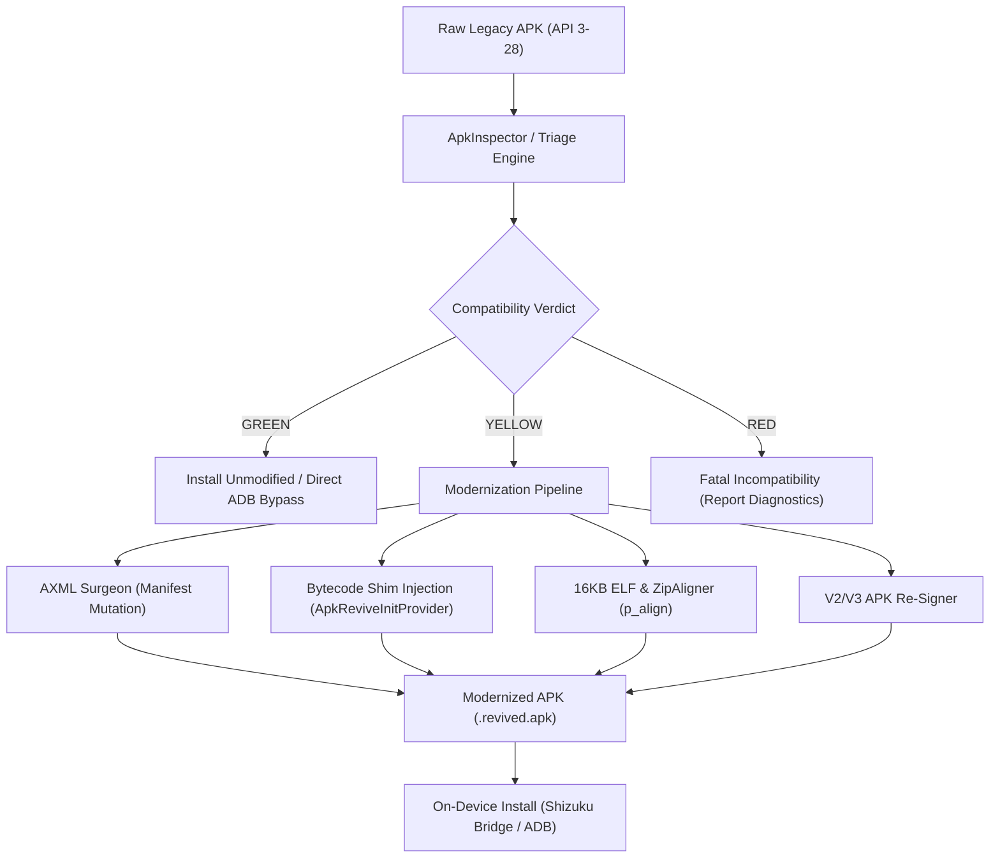

# ApkRevive v3.3

[](https://python.org)
[](https://developer.android.com)
[](https://developer.android.com/guide/practices/page-sizes)
[](LICENSE)

**ApkRevive** is a production-grade legacy Android APK modernization pipeline and compatibility layer. It diagnoses, patches, and adapts legacy applications targeting Android API levels 3 through 28 (Android 1.5 Cupcake to Android 9 Pie) so they install, boot, and run reliably on modern Android runtimes (API 34–36+, Android 14/15/16 QPR) with 16KB page sizes, modern targetSdk install floors, strict bionic namespace isolation, and high-refresh displays.

---

## Architecture Overview



---

## Key Capabilities

### 1. Authoritative Triage Engine
Evaluates legacy APK metadata against target device profiles to generate actionable **GREEN**, **YELLOW**, or **RED** verdicts:
- **ABI Verification:** Validates APK native libraries against target device CPU architectures (`arm64-v8a`, `armeabi-v7a`, `x86_64`).
- **16KB Page Size Audit:** Scans 64-bit ELF shared libraries (`.so`) for `p_align >= 16384` compliance required by Android 15+.
- **Bionic Linker Greylist Detection:** Catches private system library linkage (`libandroid_runtime.so`, `libcutils.so`, `libcrypto.so`, `libgui.so`) blocked by Android 7.0+ namespace isolation.
- **Install Floor Compliance:** Identifies targetSdk levels blocked by Android's `min_install_version` policy and selects the appropriate bypass method.

### 2. In-Memory AXML Surgeon
Mutates compiled Android binary XML (`AndroidManifest.xml`) directly in-place without decompiling resources or invoking heavyweight tools (`apktool`, `aapt`):
- Injects `<uses-library android:name="org.apache.http.legacy" android:required="false" />` for API 28+ runtimes.
- Sets `android:resizeableActivity="true"` and removes restrictive `android.max_aspect` metadata to unlock modern widescreen aspect ratios (18:9, 20:9, foldables).
- Forces `android:hasCode="true"` when injecting initialization shims into resource-only APKs.
- Injects metadata flags for runtime display controls.

### 3. Runtime Shim & Display Adaptation
Provides a zero-overhead content provider shim (`ApkReviveInitProvider` in `shim.dex`) that hooks application launch:
- **60Hz Display Mode Lock:** Fixes game physics and animations that decouple or run at hyperspeed on 90Hz/120Hz/144Hz displays due to fixed-delta game loops.
- **Display Cutout Layout:** Configures `LAYOUT_IN_DISPLAY_CUTOUT_MODE_SHORT_EDGES` to eliminate aggressive letterboxing around camera punches and notches.

### 4. 16KB Alignment & Zip Re-Packing
- Enforces strict 4-byte resource alignment and 16,384-byte (16KB) uncompressed alignment for native `.so` payloads.
- Strips invalid legacy signature blocks (`META-INF/*.SF`, `*.RSA`, `*.DSA`, `*.MF`) and signs with deterministic APK Signature Scheme v2/v3.

### 5. OBB Expansion Delivery Validator
- Validates Google Play Expansion File (OBB) naming patterns (`main.V.packageName.obb` / `patch.V.packageName.obb`).
- Detects version drift where expansion version codes lead or lag APK `versionCode`.

### 6. Shizuku-Powered Android Companion App (`apkrevive-android`)
- Native on-device companion app built with Jetpack Compose.
- Connects to Shizuku to install low-targetSdk packages without requiring a PC, root access, or terminal ADB.

---

## Project Structure

```
ApkRevive/
├── apkrevive/                  # Core Python Modernizer Engine & CLI
│   ├── adb/                    # ADB bridge and device install-floor probe
│   ├── core/                   # Triage, AXML surgeon, ELF parser, aligner, signer, OBB
│   ├── shim/                   # Precompiled bytecode shim (ApkReviveInitProvider)
│   └── cli.py                  # CLI entrypoint (`apkrevive`)
├── apkrevive-android/          # On-device companion app (Kotlin, Compose, Shizuku)
│   ├── app/src/main/           # Android app source & installer bridge
│   └── build.gradle.kts        # Gradle build configuration
├── canaries/                   # 8 pairs of control & failing verification canaries
│   ├── src/                    # C/Java sources and canary manifests
│   └── build_canaries.py       # Deterministic canary test harness
├── tests/                      # Full pytest/unittest test suite
├── pyproject.toml              # Python package metadata & dependencies
└── README.md
```

---

## Installation

### Prerequisites
- Python 3.9+
- Android SDK build-tools (for `zipalign` and `apksigner` in PATH, optional if using internal fallback)
- Android device with USB debugging (for ADB commands) or Shizuku installed (for on-device app)

### Install Python CLI
```bash
git clone https://github.com/garouthehumanmonster/ApkRevive.git
cd ApkRevive
pip install -e .
```

---

## CLI Usage

### 1. Triage an APK
Inspect an APK and get a compatibility report against target device specifications:
```bash
apkrevive triage path/to/legacy_game.apk --device-api 35 --device-abis arm64-v8a --page-size 16384
```

Example JSON response:
```json
{
  "verdict": "YELLOW",
  "reason": "MODIFICATION_REQUIRED",
  "install_method": "BYPASS_LOW_TARGET_SDK_BLOCK",
  "required_transforms": [
    "EXPAND_ASPECT_RATIO",
    "INJECT_USES_LIBRARY_APACHE_HTTP"
  ],
  "warnings": [
    "TARGET_SDK_BELOW_DEVICE_FLOOR"
  ],
  "details": "APK targetSdk 22 is below device install floor 24"
}
```

### 2. Revive & Modernize an APK
Apply necessary binary transforms, inject runtime shims, re-align, and sign the APK:
```bash
apkrevive revive path/to/legacy_game.apk --output output/revived_game.apk --enable-60hz --enable-cutout
```

### 3. Probe Connected Device
Detect the connected device's OS version, CPU architectures, page size, and enforce install floor via ADB:
```bash
apkrevive probe
```

### 4. Validate OBB Delivery
Check whether an expansion file matches the target package and APK version:
```bash
apkrevive push-obb main.100.com.example.game.obb com.example.game --current-apk-version 100
```

---

## Canary Verification Suite

ApkRevive includes 8 pairs of control and failing canary test vectors (16 APKs total) validating every failure mode:

| # | Canary Name | Focus Area | Failure Trigger Tested |
|---|---|---|---|
| 1 | `canary_install_floor` | Package Manager | targetSdk below device install floor (`INSTALL_FAILED_DEPRECATED_SDK_VERSION`) |
| 2 | `canary_apache_http` | Java Runtime | Missing `org.apache.http.legacy` library on API 28+ |
| 3 | `canary_page_size` | Native Linker | 4KB ELF `p_align` on 16KB memory page kernel |
| 4 | `canary_physics_tick` | Surface / Render | Fixed physics timestep failure on >60Hz high-refresh displays |
| 5 | `canary_aspect_ratio` | Window Manager | Fixed 4:3 / 16:9 pillarboxing on modern widescreen devices |
| 6 | `canary_bionic_greylist` | Bionic Linker | Direct dependency on private system `.so` (e.g. `libgui.so`) |
| 7 | `canary_has_code` | ART / Zygote | `hasCode="false"` preventing bytecode execution |
| 8 | `canary_obb_version` | Storage / Expansion | OBB version code mismatch or ahead of APK versionCode |

---

## Running Tests

Execute the full test suite with Python `unittest` or `pytest`:
```bash
python -m unittest discover -s tests
```

---

## License

Distributed under the Apache 2.0 License. See `LICENSE` for details.
