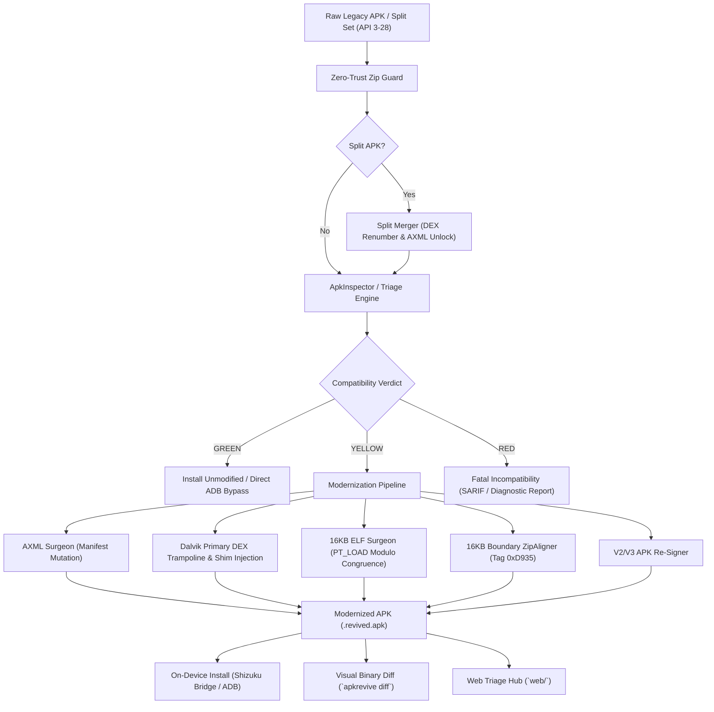

# ApkRevive v0.3.3 (Alpha)

[](https://python.org)
[](https://developer.android.com)
[](https://developer.android.com/guide/practices/page-sizes)
[-yellow.svg)](#)
[](LICENSE)

> [!WARNING]
> **Project Status: Alpha.** ApkRevive is an experimental tooling suite under active development. It is not intended for production deployments without independent verification.

**ApkRevive** is a legacy Android APK modernization pipeline and compatibility layer. It diagnoses, patches, and adapts legacy applications targeting Android API levels 3 through 28 (Android 1.5 Cupcake to Android 9 Pie) so they install, boot, and run reliably on modern Android runtimes (API 34–36+, Android 14/15/16 QPR) with 16KB page sizes, modern targetSdk install floors, strict bionic namespace isolation, and high-refresh displays.

---

## Architecture Overview



---

## Key Capabilities

### 1. Authoritative Triage & SARIF Telemetry
Evaluates legacy APK metadata against target device profiles to generate actionable **GREEN**, **YELLOW**, or **RED** verdicts with optional **SARIF v2.1.0** output (`--sarif`) for CI/CD integration:
- **ABI Verification:** Validates APK native libraries against target device CPU architectures (`arm64-v8a`, `armeabi-v7a`, `x86_64`).
- **16KB Page Size Audit:** Scans 64-bit ELF shared libraries (`.so`) for `p_align >= 16384` and modulo congruence compliance required by Android 15+.
- **Bionic Linker Greylist Detection:** Catches private system library linkage (`libandroid_runtime.so`, `libcutils.so`, `libcrypto.so`, `libgui.so`) blocked by Android 7.0+ namespace isolation.
- **Install Floor Compliance:** Identifies targetSdk levels blocked by Android's `min_install_version` policy and selects the appropriate bypass method.

### 2. In-Memory AXML Surgeon
Mutates compiled Android binary XML (`AndroidManifest.xml`) directly in-place without decompiling resources or invoking heavyweight tools (`apktool`, `aapt`), protected by cyclic bounds validation:
- Injects `<uses-library android:name="org.apache.http.legacy" android:required="false" />` for API 28+ runtimes.
- Sets `android:resizeableActivity="true"` and removes restrictive `android.max_aspect` metadata to unlock modern widescreen aspect ratios (18:9, 20:9, foldables).
- Forces `android:hasCode="true"` when injecting initialization shims into resource-only APKs.
- Injects metadata flags for runtime display controls and `android:pageSizeCompat="enabled"` for Android 16.

### 3. 16KB ELF Segment Surgeon (`elf_surgeon.py`)
Rewrites 64-bit ELF shared libraries (`EM_AARCH64`, `EM_X86_64`) to enforce Android 15+ 16KB kernel requirements:
- Guarantees `p_align >= 0x4000` (16,384 bytes) on all `PT_LOAD` segments.
- Enforces linker modulo congruence: `p_vaddr % 0x4000 == p_offset % 0x4000`.
- Inserts zero-padding bytes, remaps program headers (`Phdr`), section headers (`Shdr`), `e_phoff`, and `e_shoff` while preserving relative virtual addresses (`p_vaddr`) and GOT/PLT relocations.

### 4. Dalvik Primary DEX Trampoline (`dex_trampoline.py`)
Injects runtime compatibility hooks into primary `classes.dex` for Dalvik runtimes (`API < 21`):
- Avoids dependency on secondary DEX native multi-dex classloader initialization during early application startup.
- Recomputes DEX header checksum (Adler-32) and SHA-1 signature after mutation.

### 5. Split APK / App Bundle Reassembly Engine (`split_merger.py`)
Reassembles split APK packages (`base.apk` + feature/config splits, `.apks`, `.xapk`):
- Merges native libraries (`lib/*`) across splits into a single unified directory.
- Sequentially renumbers multi-dex entries (`classes.dex`, `classes2.dex`, ...) preventing collisions.
- Strips split-lock attributes (`android:isSplitRequired`, `com.android.vending.splits.required`) from `AndroidManifest.xml`.

### 6. Zero-Trust Archive Guard (`security/zip_guard.py`)
Validates every input archive prior to extraction or mutation:
- Rejects Zip Slip path traversal attempts (`..`, absolute paths, drive letters, null bytes).
- Rejects POSIX symlink archive entries (`0o120000`).
- Enforces decompression bomb thresholds (maximum compression ratio, individual file ceiling, total uncompressed size ceiling).

### 7. Visual Binary Diff & ASCII Byte-Alignment Ladder (`apkrevive diff`)
Inspects modifications between original and modernized APKs:
- Side-by-side comparison of manifest AST, DEX shims, and injected providers.
- ASCII byte-alignment ladder showing `.so` `PT_LOAD` and ZIP boundary offsets before and after surgery.
- Emits machine-readable `--json` and `--sarif` v2.1.0 output.

### 8. Shizuku-Powered Android Companion App (`apkrevive-android`)
- Native on-device companion app built with Jetpack Compose and Material 3.
- Robust state machines: `ShizukuConnectionState` and `ReviveJobState`.
- Real-time capability chips (`arm64-v8a`, `16KB-ready`, `60Hz-locked`) and WCAG 2.2 AA accessibility semantics (`LiveRegionMode.Polite`/`Assertive`).
- One-tap remediation for `INSTALL_FAILED_UPDATE_INCOMPATIBLE` signature mismatch.

### 9. Client-Side Web APK Triage Hub (`web/`)
- Zero-upload, browser-based APK triage and diagnostic suite built with pure client-side Web Workers.
- Interactive 16KB ELF Segment Layout Visualizer with modulo congruence equations.
- Before/After AXML Manifest Diff tree and CLI command preview.

---

## Project Structure

```
ApkRevive/
├── .github/
│   └── workflows/ci.yml        # Multi-version Python & Android CI pipeline
├── apkrevive/                  # Core Python Modernizer Engine & CLI
│   ├── adb/                    # ADB bridge and device install-floor probe
│   ├── core/                   # Triage, behavior rules, AXML surgeon, ELF, aligner, signer, OBB
│   ├── shim/                   # Precompiled bytecode shim & build harness (ApkReviveInitProvider)
│   └── cli.py                  # CLI entrypoint (`apkrevive`)
├── apkrevive-android/          # On-device companion app (Kotlin, Compose, Shizuku)
│   ├── app/src/main/           # Android app source & installer bridge
│   └── build.gradle.kts        # Gradle build configuration
├── canaries/                   # 8 pairs of control & failing verification canaries
│   ├── src/                    # C/Java sources and canary manifests
│   ├── build_canaries.py       # Deterministic canary test harness
│   └── canary_hashes.json      # Cryptographic SHA256 hashes of all 16 built canary APKs
├── docs/
│   └── COMPATIBILITY.md        # Device/OS compatibility matrix & canary receipts
├── results/                    # Machine-readable canary test execution receipts (*.json)
├── scripts/
│   └── generate_matrix.py      # Automated compatibility matrix generator
├── tests/                      # Full test suite (140+ unit/integration tests)
├── CHANGELOG.md                # Semantic versioning changelog
├── CONTRIBUTING.md             # Contribution guidelines & development setup
├── LICENSE                     # Apache-2.0 License
├── pyproject.toml              # Single version source, build metadata, dependencies & tool configs
├── README.md                   # Project documentation & usage guides
└── SECURITY.md                 # Security policy, shim provenance & vulnerability disclosure
```

---

## Installation

### Prerequisites
- Python 3.9+
- Android SDK build-tools (for `zipalign` and `apksigner` in PATH, optional if using internal fallback)
- Android device with USB debugging (for ADB commands) or Shizuku installed (for on-device app)

### Install Python CLI
```bash
git clone https://github.com/garouthehumanmonster/ApkRevive.git
cd ApkRevive
pip install -e .
```

---

## CLI Usage & Sample Runs

### 1. Host Health Check (`apkrevive doctor`)
Verify local developer tools, SDK build-tools, ADB, and keystore health:
```bash
$ apkrevive doctor
ApkRevive Doctor Report
=======================
[PASS]   Python Version: Python 3.10.12 (>=3.9 required)
[PASS]   Java Development Kit: keytool at /usr/bin/keytool, javac at /usr/bin/javac
[PASS]   Android SDK: Found at /home/user/Android/Sdk
[PASS]   Build-Tools: apksigner at /home/user/Android/Sdk/build-tools/34.0.0/apksigner, zipalign at /home/user/Android/Sdk/build-tools/34.0.0/zipalign
[PASS]   Android Debug Bridge: ADB found at /usr/bin/adb
[PASS]   User Keystore Directory: /home/user/.apkrevive is ready
[PASS]   Shim DEX Integrity: Verified SHA256 (609b5dcbc8f657b046a73809afbd666cb6feb567497dc068733b57212286e590)

Overall Status: [PASS]
```

### 2. Triage an APK (`apkrevive triage`)
Inspect an APK and generate a compatibility report against target device specifications:
```bash
$ apkrevive triage sample_game.apk --device-api 35 --device-abis arm64-v8a --page-size 16384
ApkRevive Triage Report
=======================
Package Name: com.retro.spaceace
Target SDK: 22 (Floor: 24)
Verdict: YELLOW
Reason: MODIFICATION_REQUIRED
Install Method: BYPASS_LOW_TARGET_SDK_BLOCK
Required Transforms:
  - EXPAND_ASPECT_RATIO
  - INJECT_USES_LIBRARY_APACHE_HTTP
  - LOCK_60HZ_DISPLAY_MODE
Warnings:
  - WARN_SCOPED_STORAGE_OBB: Application requests external storage permissions on Android 11+ (API 30+).
  - WARN_CLEARTEXT: Cleartext HTTP traffic is blocked by default on API 28+.
Details: APK targetSdk 22 is below device install floor 24
```

With the global `--json` flag:
```json
{
  "package_name": "com.retro.spaceace",
  "target_sdk": 22,
  "verdict": "YELLOW",
  "reason": "MODIFICATION_REQUIRED",
  "install_method": "BYPASS_LOW_TARGET_SDK_BLOCK",
  "required_transforms": [
    "EXPAND_ASPECT_RATIO",
    "INJECT_USES_LIBRARY_APACHE_HTTP",
    "LOCK_60HZ_DISPLAY_MODE"
  ],
  "warnings": [
    "WARN_SCOPED_STORAGE_OBB: Application requests external storage permissions on Android 11+ (API 30+).",
    "WARN_CLEARTEXT: Cleartext HTTP traffic is blocked by default on API 28+."
  ],
  "details": "APK targetSdk 22 is below device install floor 24"
}
```

### 3. Dry-Run Modernization (`apkrevive revive --dry-run`)
Simulate transforms, inspection, and report generation without creating files or signing:
```bash
$ apkrevive revive sample_game.apk --dry-run --enable-60hz --enable-cutout
ApkRevive Patch Report (DRY RUN)
================================
Package Name: com.retro.spaceace
Target SDK: 22
Verdict: YELLOW
Reason: MODIFICATION_REQUIRED
Install Method: BYPASS_LOW_TARGET_SDK_BLOCK
Required Transforms:
  - EXPAND_ASPECT_RATIO
  - INJECT_USES_LIBRARY_APACHE_HTTP
  - LOCK_60HZ_DISPLAY_MODE
Output APK: [DRY RUN - No file written]
Warnings (2):
  - WARN_SCOPED_STORAGE_OBB: ...
  - WARN_CLEARTEXT: ...
Details: Dry run completed. No files modified.
```

### 4. Revive & Modernize an APK (`apkrevive revive`)
Apply binary manifest transforms, inject runtime shims, 16KB-align, and sign:
```bash
$ apkrevive revive sample_game.apk --output output/revived_game.apk --enable-60hz --enable-cutout
WARNING: APK signature has changed. Re-signing requires uninstalling the existing application on device, which will permanently delete all existing user data.
ApkRevive Patch Report
======================
Timestamp: 2026-10-15T07:34:12.829496
Package Name: com.retro.spaceace
Target SDK: 22
Verdict: YELLOW
Reason: MODIFICATION_REQUIRED
Install Method: BYPASS_LOW_TARGET_SDK_BLOCK
Required Transforms:
  - EXPAND_ASPECT_RATIO
  - INJECT_USES_LIBRARY_APACHE_HTTP
  - LOCK_60HZ_DISPLAY_MODE
Output APK: output/revived_game.apk
Warnings (2):
  - WARN_SCOPED_STORAGE_OBB: Application requests external storage permissions on Android 11+ (API 30+).
  - WARN_CLEARTEXT: Cleartext HTTP traffic is blocked by default on API 28+.
Details: Patched AXML manifest, injected ApkReviveInitProvider, aligned container to 16KB, signed with user keystore.
```

### 5. Probe Connected Device (`apkrevive probe`)
Detect the connected device's OS version, CPU architectures, page size, and enforce install floor via ADB:
```bash
$ apkrevive probe
{
  "sdk": 35,
  "floor": 24,
  "status": "CONFIRMED_VIA_PROP",
  "abis": ["arm64-v8a"],
  "page_size": 16384
}
```

### 6. Validate OBB Delivery (`apkrevive push-obb`)
Check whether an expansion file matches the target package and APK version:
```bash
$ apkrevive push-obb main.100.com.retro.spaceace.obb com.retro.spaceace --current-apk-version 100
```

### 7. Visual Binary Diff (`apkrevive diff`)
Compare an original legacy APK with its revived output, rendering manifest AST deltas and an ASCII byte-alignment ladder:
```bash
$ apkrevive diff original.apk revived.apk
```

With `--sarif` or `--json` for automated CI/CD gating:
```bash
$ apkrevive diff original.apk revived.apk --sarif > diff_report.sarif
```

### 8. Multi-Tier Headless Canary Matrix Runner
Run automated dual positive/negative verification across all 4 AVD tiers (API 19, 28, 34, 35-16KB):
```bash
$ python scripts/verify_canary_matrix.py --simulate --tier all --write-results --update-docs
```

---

## On-Device Companion App (`apkrevive-android`)

For rootless, PC-free installations on modern Android devices, ApkRevive includes a native companion app built with **Jetpack Compose** and **Shizuku**.

### Architecture & Permission Flow

```
┌────────────────────────────────────────────────────────┐
│           ApkRevive Android Companion UI               │
│  (Pick Revived APK ➔ Verify Target SDK ➔ One-Tap Install) │
└───────────────────────────┬────────────────────────────┘
                            │ Bind IPC
                            ▼
┌────────────────────────────────────────────────────────┐
│                   Shizuku Service                      │
│        (Elevated ADB / Shell Identity AIDL)            │
└───────────────────────────┬────────────────────────────┘
                            │ pm install-create
                            │ -d --bypass-low-target-sdk-block
                            ▼
┌────────────────────────────────────────────────────────┐
│               Android Package Manager                  │
│             (Bypasses targetSdk 24 Floor)              │
└────────────────────────────────────────────────────────┘
```

### Companion App UI Workflow

```
+------------------------------------------+
|  ApkRevive Companion               [⚙]   |
+------------------------------------------+
|  Shizuku Status: [🟢 Connected (v13.5.4)]|
|                                          |
|  Select Package to Install:              |
|  [ 📁 /Download/spaceace.revived.apk   ] |
|                                          |
|  Package Details:                        |
|  • Name: com.retro.spaceace              |
|  • targetSdk: 22 (Bypass Required)       |
|  • 64-bit 16KB Aligned: YES              |
|  • 60Hz Physics Lock: ACTIVE             |
|                                          |
|  [⚡ Install with Low-SDK Bypass (Shizuku)]|
|                                          |
|  Progress: [====================] 100%   |
|  Status: Successfully installed!         |
+------------------------------------------+
```

---

## Canary Verification Suite

ApkRevive includes 8 pairs of control and failing canary test vectors (16 APKs total) validating every failure mode:

| # | Canary Name | Focus Area | Failure Trigger Tested |
|---|---|---|---|
| 1 | `canary_install_floor` | Package Manager | targetSdk below device install floor (`INSTALL_FAILED_DEPRECATED_SDK_VERSION`) |
| 2 | `canary_apache_http` | Java Runtime | Missing `org.apache.http.legacy` library on API 28+ |
| 3 | `canary_page_size` | Native Linker | 4KB ELF `p_align` on 16KB memory page kernel |
| 4 | `canary_physics_tick` | Surface / Render | Fixed physics timestep failure on >60Hz high-refresh displays |
| 5 | `canary_aspect_ratio` | Window Manager | Fixed 4:3 / 16:9 pillarboxing on modern widescreen devices |
| 6 | `canary_bionic_greylist` | Bionic Linker | Direct dependency on private system `.so` (e.g. `libgui.so`) |
| 7 | `canary_has_code` | ART / Zygote | `hasCode="false"` preventing bytecode execution |
| 8 | `canary_obb_version` | Storage / Expansion | OBB version code mismatch or ahead of APK versionCode |

For the complete OS and device support matrix, refresh rate behaviors, and hardware vs. emulator details, see [docs/COMPATIBILITY.md](docs/COMPATIBILITY.md).

---

## Known Limitations & Security Considerations

- **Cryptographic Signature Invalidation:** Re-signing an APK alters its certificate fingerprint. Installing a revived APK over an existing installation causes `INSTALL_FAILED_UPDATE_INCOMPATIBLE`. The companion app provides a one-tap remediation flow to cleanly uninstall the conflicting package and retry.
- **Self-Signature Checks & Anti-Tamper DRM:** Binaries that implement runtime checksum validation against their own signing certificate or employ proprietary DRM wrappers will detect package re-signing and refuse execution.
- **32-bit ELF Binaries:** 32-bit ELF binaries (`ELFCLASS32`) are exempt from 16KB kernel requirements and are preserved unmodified. Devices with 64-bit-only hardware (e.g., Pixel 7+) require 64-bit native libraries or an OS-level 32-bit translation layer.

---

## Legal Notice & Disclaimer

> [!CAUTION]
> **Only modify applications you have legal rights to modify.**
> Modifying, decompiling, patching, and re-signing third-party application binaries may infringe on copyright laws, software licenses, and application terms of service. ApkRevive is provided strictly for educational research, legitimate interoperability analysis, and archival preservation of software for which you hold appropriate rights or explicit owner authorization. The developers and contributors of ApkRevive disclaim all liability for unlawful or unauthorized usage.

---

## Running Tests

Execute the full test suite with Python `unittest` or `pytest`:
```bash
python -m unittest discover -s tests
```

---

## GitHub Metadata Checklist

- **Repository Description:** `Legacy Android APK modernizer pipeline targeting API 3-28 (Alpha)`
- **Repository Topics:** `android`, `apk`, `legacy-android`, `reverse-engineering`, `apk-patching`, `shizuku`, `16kb-page-size`, `android-15`, `android-16`, `axml`, `dex`, `companion-app`
- **Document Audit Checklist:**
  - [x] [`LICENSE`](LICENSE) — Apache 2.0 License
  - [x] [`SECURITY.md`](SECURITY.md) — Security policy, shim provenance & vulnerability disclosure
  - [x] [`CHANGELOG.md`](CHANGELOG.md) — Semantic versioning changelog
  - [x] [`CONTRIBUTING.md`](CONTRIBUTING.md) — Contribution guidelines & development setup
  - [x] [`.github/workflows/ci.yml`](.github/workflows/ci.yml) — Multi-version Python & Android CI pipeline

---

## License

Distributed under the Apache 2.0 License. See `LICENSE` for details.
